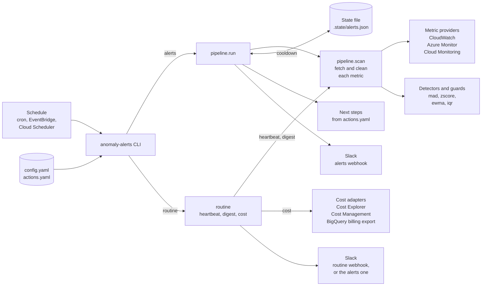
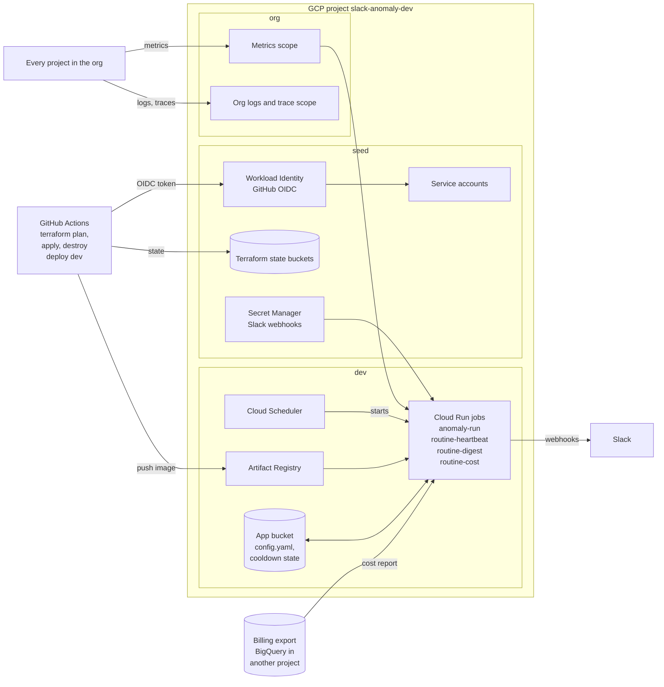

# Multi-Cloud Anomaly Alerts

Watches metrics on AWS, Azure and GCP and posts a Slack alert when one looks wrong. It runs on a schedule, makes one pass, and exits.

## Quick start

```bash
pip install -e ".[all]"                          # or .[aws], .[azure], .[gcp]
cp config/config.example.yaml config/config.yaml # list your metrics
cp .env.example .env                             # set SLACK_WEBHOOK_URL
anomaly-alerts --config config/config.yaml --dry-run
```

Remove `--dry-run` to post to Slack.

## Commands

| Command | Does |
| --- | --- |
| `anomaly-alerts --config FILE` | Alert on anomalies |
| `anomaly-alerts routine --config FILE` | Post a heartbeat (see [Routine reports](#routine-reports)) |
| `... routine --kind digest` | Post a health digest of every metric |
| `... routine --kind cost` | Post yesterday's spend per account |

Options: `--dry-run` prints instead of posting, `--only aws|azure|gcp` runs one cloud, `--verbose` adds debug logs.

Exit codes: `0` ok, `1` a fetch or post failed, `2` bad config.

## Architecture

Each run is one short process. Alerts and routine reports share the same scan, then go their own way.



This repo's own deployment, on GCP. Each box is one Terraform root under `terraform/gcp`.



## How a run works

1. Read the config. The Slack webhook URL comes from an environment variable, never the file.
2. Fetch each metric. If one fails, it is logged and the rest carry on.
3. Compare the newest points to earlier ones using a detector: `mad` (default), `zscore`, `ewma` or `iqr`.
4. Call it an anomaly only if there is enough history, it lasts several points, the change is big enough, and it goes in a direction the metric cares about.
5. Skip alerts already sent within the cooldown, unless they got worse.
6. Add recommended next steps from `config/actions.yaml`.
7. Post to Slack, most severe first, up to a limit per run.

To watch a whole GCP org, point a metric at the scoping project and set `group_by: [resource.labels.project_id]`, so each project alerts on its own (see `terraform/gcp/org`).

Credentials come from each cloud SDK's usual login, and read-only access is enough. The cost report also needs billing read access: `ce:GetCostAndUsage` on AWS, Cost Management Reader on Azure, and on GCP BigQuery Data Viewer on the billing export dataset plus BigQuery Job User.

## Routine reports

Alerts only post when something is wrong, so a quiet channel could mean healthy or broken. Routine reports post on a schedule either way, so you know the tool is running.

- **Heartbeat** (`routine`): a short "still alive" message with how many metrics were checked, how many anomalies there are right now, and which metrics could not be fetched. Run it every few hours.
- **Digest** (`routine --kind digest`): one line per metric, problems first, showing its latest value against its normal level. New metrics show how much history they still need. Run it once a day.
- **Cost** (`routine --kind cost`): yesterday's spend per account against its 7-day average, plus month to date and the top services. A day 25% or more above the average is flagged. List the accounts in the `cost` section of the config. On GCP, turn on the Cloud Billing export to BigQuery first; it takes about a day to fill. Run it once a day.

Set `slack.routine_webhook_env` to send these to their own channel. Failed metrics or accounts are named, but error details are left out because they can contain account IDs.

## Scheduling

[cron](examples/cron.md) · [AWS EventBridge](examples/eventbridge.md) · [GCP Cloud Scheduler and Azure](examples/cloud-scheduler.md)

This repo's own deployment runs on GCP Cloud Run: see [terraform/gcp/dev](terraform/gcp/dev/README.md).
