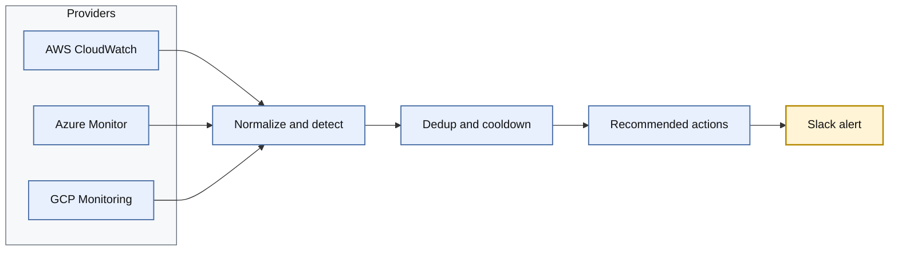

# Multi-Cloud Anomaly Alerts

A Python tool that pulls metrics from AWS CloudWatch, Azure Monitor and GCP Cloud Monitoring and flags anomalies using simple statistical methods. Each anomaly is posted to Slack as a rich alert with the observed value, the baseline, and recommended next steps. It runs as a short-lived job on any scheduler and is configured with a single YAML file.

## Quick start

```bash
pip install -e ".[all]"                # or .[aws], .[azure], .[gcp]
cp config/config.example.yaml config/config.yaml
cp .env.example .env                   # set SLACK_WEBHOOK_URL
anomaly-alerts --config config/config.yaml --dry-run
```

Options: `--dry-run` prints payloads without posting, `--only aws|azure|gcp` runs one cloud, `--verbose` turns on debug logging. Exit codes: `0` ok, `1` a fetch or post failed, `2` bad config.

Detectors: `mad` (default), `zscore`, `ewma`, `iqr`. Recommended actions live in `config/actions.yaml`.

Scheduler setups: [cron](examples/cron.md), [AWS EventBridge](examples/eventbridge.md), [GCP Cloud Scheduler and Azure](examples/cloud-scheduler.md).

## Architecture

The tool is a short-lived batch job. It has no server, no database and no long-running agent: a scheduler starts it, it does one pass over the configured metrics, posts any new alerts to Slack, and exits. The only thing it keeps between runs is a small JSON file that records which alerts were already sent.

Only the provider adapters know which cloud a metric came from. Each one turns its SDK response into the same `Series` (timestamped values, oldest first), and every stage after that works on `Series` alone. Adding a cloud means adding one adapter.



### How a run works

1. **Load config.** The YAML file lists the metrics to watch. The Slack webhook URL is read from an environment variable and is never stored in the file.
2. **Fetch.** For each metric, the matching provider (`boto3`, `azure-monitor-query` or `google-cloud-monitoring`) pulls the lookback window using the runner's own cloud credentials. The newest period is skipped because cloud metrics arrive late. A failed fetch is logged and does not stop the other metrics.
3. **Detect.** The chosen detector scores the latest points against a baseline built from earlier points. Four are available: modified z-score (`mad`, the default), `zscore`, `ewma` and `iqr`.
4. **Guard.** A score only counts as an anomaly if it passes every guard: enough baseline history, a sustained breach across consecutive points, a deviation larger than the metric's `min_abs_change`, and a direction the metric alerts on (spike, drop or both). A flat baseline falls back to a percentage-change rule.
5. **Dedup.** Each anomaly has a fingerprint (cloud, account, resource, metric, direction). A fingerprint stays silent during the cooldown, unless the alert escalated from warning to critical.
6. **Enrich.** A rule table in `config/actions.yaml` matches the metric category and direction to ordered next steps. With no match, the alert gets a generic step.
7. **Post.** One Slack Block Kit message per anomaly, critical first, up to `max_alerts_per_run`. Anything beyond the cap becomes a single "N more suppressed" notice.

Severity is `warning` when the score passes the detector threshold, and `critical` at twice the threshold or when the breach lasts twice the minimum window.

### Components

| Module | Responsibility |
| --- | --- |
| `cli.py` | Parse arguments, wire the pieces together, set the exit code |
| `config.py` | Load and validate the YAML config |
| `models.py` | `MetricSpec`, `Series`, `Anomaly` |
| `providers/` | One adapter per cloud behind a shared `fetch` interface |
| `detectors/` | The four detectors and the shared guards |
| `state.py` | Dedup and cooldown file |
| `actions.py` | Match an anomaly to recommended steps |
| `slack/` | Block Kit builder and webhook client |
| `pipeline.py` | Runs the stages above in order |

### Design choices

- **Stateless apart from the cooldown file.** A scheduler such as cron, EventBridge or Cloud Scheduler decides when to run. On a runner with no persistent disk, point `state.path` at a mounted volume, or the cooldown resets on every run.
- **Standard-library statistics.** The detectors use only Python's `statistics` module, with no ML or forecasting.
- **Credentials from each SDK's default chain.** The tool needs read-only metric access only, and a cloud can be left out of the config entirely. SDKs load lazily, so a missing one only matters if that cloud is configured.
- **Exit codes.** `0` ok, `1` a fetch or Slack post failed, `2` bad config or setup, so a scheduler can alert on failures.
