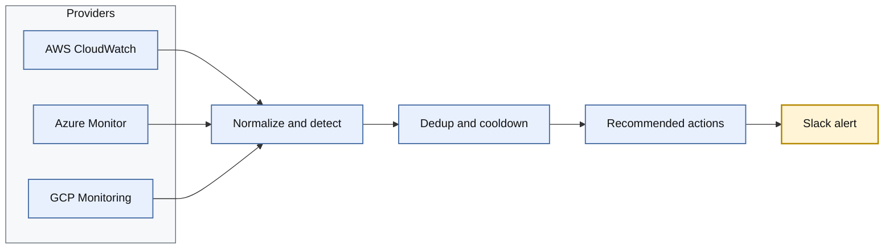

# Multi-Cloud Anomaly Alerts

A Python tool that pulls metrics from AWS CloudWatch, Azure Monitor and GCP Cloud Monitoring and flags anomalies using simple statistical methods. Each anomaly is posted to Slack as a rich alert with the observed value, the baseline, and recommended next steps. It runs as a short-lived job on any scheduler and is configured with a single YAML file.

