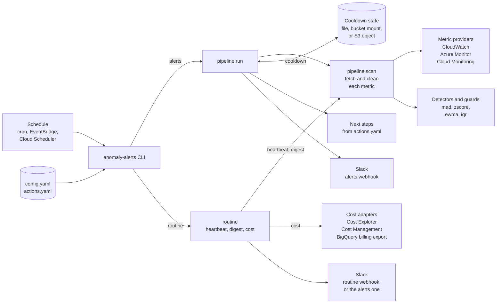
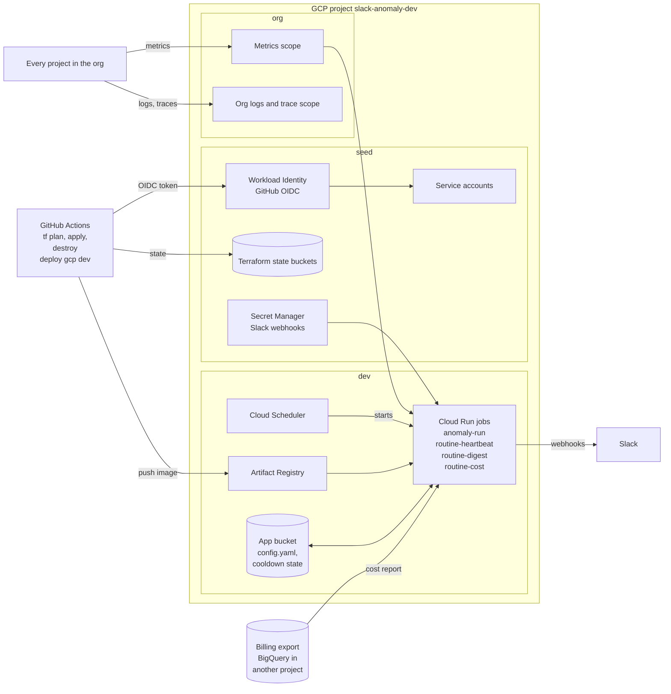

# Multi-Cloud Anomaly Alerts

Watches metrics on AWS, Azure and GCP and posts a Slack alert when one looks wrong. It runs on a schedule, makes one pass, and exits.

The code supports all three clouds. This repo's own deployment is built one cloud at a time:

| Cloud | Metrics and cost code | Deployed | Terraform |
| --- | --- | --- | --- |
| GCP | yes | yes, as Cloud Run jobs on Cloud Scheduler | `terraform/gcp`: `seed`, `dev`, `org` |
| AWS | yes | not yet, the seed is written but not applied | `terraform/aws`: `seed`; `dev` is next |
| Azure | yes | not yet | none yet |

## Quick start

```bash
pip install -e ".[all]"                          # or .[aws], .[azure], .[gcp]
cp config/config.example.yaml config/config.yaml # list your metrics
echo "SLACK_WEBHOOK_URL=<your Slack webhook URL>" > .env  # also SLACK_ROUTINE_WEBHOOK_URL, optional
anomaly-alerts --config config/config.yaml --dry-run
```

Remove `--dry-run` to post to Slack.

## Commands

| Command | Does |
| --- | --- |
| `anomaly-alerts --config FILE` | Alert on anomalies |
| `anomaly-alerts routine --config FILE` | Post a heartbeat (see [Routine reports](#routine-reports)) |
| `... routine --kind digest` | Post a health digest of every metric |
| `... routine --kind cost` | Post yesterday's spend per account |

Options: `--dry-run` prints instead of posting, `--only aws|azure|gcp` runs one cloud, `--verbose` adds debug logs.

Exit codes: `0` ok, `1` a fetch or post failed, `2` bad config.

On AWS Lambda, `anomaly_alerts.handler.lambda_handler` runs the same commands from an event such as `{"command": "routine", "kind": "cost"}`. The config path comes from the `ANOMALY_CONFIG` environment variable, and a non-zero exit raises, so Lambda records the failure.

## Architecture

Each run is one short process. Alerts and routine reports share the same scan, then go their own way.



This repo's own deployment, on GCP. Each box is one Terraform root under `terraform/gcp`.



## How a run works

1. Read the config. The Slack webhook URL comes from an environment variable, never the file.
2. Fetch each metric. If one fails, it is logged and the rest carry on.
3. Compare the newest points to earlier ones using a detector: `mad` (default), `zscore`, `ewma` or `iqr`.
4. Call it an anomaly only if there is enough history, it lasts several points, the change is big enough, and it goes in a direction the metric cares about.
5. Skip alerts already sent within the cooldown, unless they got worse.
6. Add recommended next steps from `config/actions.yaml`.
7. Post to Slack, most severe first, up to a limit per run.

Each run looks at the newest `sustained_points` points (3 by default). With 5 minute points that is about 15 minutes, so a breach is caught only if it is still going when the run happens. Running less often, for example hourly, saves cost but misses spikes that start and end between two runs.

To watch a whole GCP org, point a metric at the scoping project and set `group_by: [resource.labels.project_id]`, so each project alerts on its own (see `terraform/gcp/org`).

Credentials come from each cloud SDK's usual login, and read-only access is enough. The cost report also needs billing read access: `ce:GetCostAndUsage` on AWS, Cost Management Reader on Azure, and on GCP BigQuery Data Viewer on the billing export dataset plus BigQuery Job User.

## Cooldown state

The cooldown (and the heartbeat's "last alert run" line) needs a small JSON document that survives between runs. Set `state.path` in the config to one of:

- a local file, such as `.state/alerts.json`, for cron on a machine with a disk;
- a file on a mounted bucket, which is how the GCP Cloud Run jobs do it;
- `s3://bucket/key`, for AWS Lambda and anywhere else with no mounted disk. It needs the AWS extra (`boto3`) and read and write access to that object.

If the document cannot be read, the run carries on with an empty one. The worst case is a repeat alert.

## Routine reports

Alerts only post when something is wrong, so a quiet channel could mean healthy or broken. Routine reports post on a schedule either way, so you know the tool is running.

- **Heartbeat** (`routine`): a short "still alive" message with how many metrics were checked, how many anomalies there are right now, and which metrics could not be fetched. Run it every few hours.
- **Digest** (`routine --kind digest`): one line per metric, problems first, showing its latest value against its normal level. New metrics show how much history they still need. Run it once a day.
- **Cost** (`routine --kind cost`): yesterday's spend per account against its 7-day average, plus month to date and the top services. A day 25% or more above the average is flagged. List the accounts in the `cost` section of the config. On GCP, turn on the Cloud Billing export to BigQuery first; it takes about a day to fill. Run it once a day.

Set `slack.routine_webhook_env` to send these to their own channel. Failed metrics or accounts are named, but error details are left out because they can contain account IDs.

## Keeping the bill low

Cost grows with the number of metrics times the number of runs, not with lookback or period. CloudWatch bills `GetMetricData` per metric requested (about $0.01 per 1,000), so batching calls does not reduce it.

At the default 5 minute schedule, one AWS metric is 288 requests a day, about $0.09 a month. 10 metrics is about $0.90 a month and 50 is about $4.30. GCP reads fit inside Cloud Monitoring's free allowance at this size. Check each cloud's current pricing before relying on these numbers.

So keep the list short:

- Pick about 10 to 15 metrics where an alert would change what you do, such as load balancer 5xx, function errors and queue age.
- Leave out metrics you would only glance at. The daily digest can still cover them if they are in the config, so add them there only when the digest earns its cost.
- Count metrics in the config before adding a cloud. Every routine heartbeat and digest also re-fetches the whole list.

## Scheduling

The default is every 5 minutes, matching the default `period`. [cron](examples/cron.md) · [AWS EventBridge](examples/eventbridge.md) · [GCP Cloud Scheduler and Azure](examples/cloud-scheduler.md)

This repo's own deployment runs on GCP Cloud Run: see [terraform/gcp/dev](terraform/gcp/dev/README.md).

## Deployment and CI/CD

Terraform lives in one directory per cloud and environment. `seed` creates what everything else needs (state buckets, GitHub OIDC identities, webhook secrets), `dev` creates the running app, and `org` (GCP only) sets up org-wide metrics and is applied by hand. Every resource gets the tags or labels `project`, `app`, `env`, `managed_by` and `repo`.

GitHub Actions plan every Terraform root on pull requests and apply them on merge, signing in to each cloud with OIDC and no stored keys. A cloud's workflows stay switched off until its seed has been applied once from a laptop. See [.github/CICD.md](.github/CICD.md) for the workflows, naming conventions and how to add a root or a cloud.

## Development

```bash
pip install -e ".[all,dev]"
pytest
```

The tests use fake cloud clients, so they need no credentials. CI runs them on Python 3.11 and 3.12, then runs Trivy and Checkov on the Terraform.

```text
src/anomaly_alerts/   the CLI, pipeline, detectors, providers, cost adapters and Slack output
config/               example config and next-step rules
examples/             cron, EventBridge and Cloud Scheduler setups
terraform/            gcp/{seed,dev,org} and aws/seed
.github/              workflows, shared actions and the CI/CD README
```
